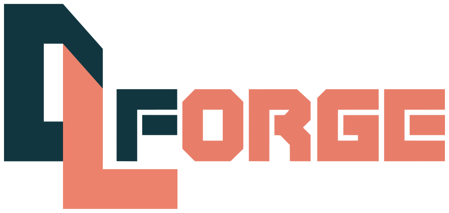

# War Thunder Triple Screen

[English](docs/README.en.md)

**Download:** https://github.com/hubertdungen/war-thunder-triple-screen/releases

**Source:** https://github.com/hubertdungen/war-thunder-triple-screen

Wrapper externo para executar o War Thunder numa fila de três monitores com
resoluções físicas diferentes, sem NVIDIA Surround. Foi preparado para o setup
local testado: centro 2560×1440 e laterais 1920×1080.

## Diagnóstico local

O War Thunder estava configurado para `7680 x 1440`, mas o Windows expunha:

```text
[ 1920×1080 ][ 2560×1440 ][ 1920×1080 ] = 6400×1440
```

Ao mesmo tempo, `7680×1440` aparecia como um modo de super resolution associado
ao monitor central. O jogo criou por isso uma janela com cerca de 7680 px sobre
um desktop com apenas 6400 px. O excesso lateral é real, não apenas distorção de
FOV.

O resultado pretendido exige que o driver exponha 2560×1440 em **cada** lateral:

```text
[ 2560×1440 efetivos ][ 2560×1440 nativos ][ 2560×1440 efetivos ]
                              = 7680×1440
```

Os painéis laterais continuam fisicamente a 1080p; a NVIDIA reduz a imagem de
1440p para o painel.

## Segurança

O wrapper:

- lê os monitores e modos disponibilizados pelo Windows/driver;
- pode selecionar temporariamente um modo 2560×1440 **já existente** nos laterais;
- guarda e restaura a resolução, frequência e posição anteriores;
- faz backup atómico do `config.blk` antes de escrever a resolução;
- abre apenas o launcher oficial;
- remove a moldura e posiciona a janela através das APIs normais do Windows.

Não injeta DLLs, não lê/escreve memória do jogo, não altera executáveis, não faz
hooks DirectX e não tenta contornar o BattlEye. Isto reduz o risco, mas não é uma
aprovação oficial da Gaijin/BattlEye.

## Preparação NVIDIA (uma vez)

Neste PC, a inspeção de 5 de agosto de 2026 mostrou que os dois laterais ainda
**não expunham 2560×1440** ao Windows. Antes da primeira execução:

1. manter NVIDIA Surround desligado;
2. no NVIDIA Control Panel, ativar o fator DSR/DLDSR que adiciona 2560×1440 aos
   monitores laterais 1920×1080 (normalmente 1,78×);
3. manter a escala do Windows em 100% nos três monitores;
4. não é preciso deixar manualmente os laterais a 1440p: o wrapper pode ativar e
   restaurar esse modo durante a sessão.

Se o driver não anunciar o modo, o wrapper para com uma mensagem explícita. Não
força um modo que o monitor/driver rejeita.

## Utilização

Fechar primeiro o War Thunder e executar:

```text
Run-WarThunderTripleScreen.cmd
```

O script deteta a instalação local, prepara a fila, atualiza `config.blk`, abre o
launcher e espera pela janela do jogo. Ao sair do War Thunder, restaura o layout
de ecrãs anterior.

Se o War Thunder já estiver aberto em `7680×1440` Windowed e faltar apenas tirar
a barra e acertar a posição, executar:

```text
Fix-Current-WarThunder-Window.cmd
```

Este modo liga-se à janela já existente e corrige-a para `x=-2560`, `y=0`,
`7680×1440` no layout de referência. Não altera `config.blk`, não muda as
resoluções dos monitores e não abre outro launcher.

Diagnóstico sem alterar nada:

```powershell
.\WarThunderTripleScreen.ps1 -DryRun
```

Recuperar o layout de monitores após uma interrupção abrupta:

```powershell
.\WarThunderTripleScreen.ps1 -RestoreDisplay
```

Restaurar o backup mais recente do `config.blk`:

```powershell
.\WarThunderTripleScreen.ps1 -RestoreConfig
```

As opções principais estão em `WarThunderTripleScreen.ini`. Os registos ficam em
`logs`.

## Limitações

É uma única superfície muito larga, não três câmaras independentes. A periferia
pode apresentar alongamento geométrico e o HUD pode ficar afastado. 7680×1440
equivale a cerca de 11,1 milhões de píxeis por frame.

## Referências

- Guia X4 usado como base: https://www.reddit.com/r/X4Foundations/comments/1vfqbe5/guide_opensource_tool_mixedresolution_triple/
- Informação BattlEye publicada pelo suporte Gaijin: https://support.gaijin.net/hc/en-us/articles/21638218281362-BattlEye-anti-cheat-troubleshooting


<p align="center"><a href="https://dlforge.dungenlabs.com"><picture><source media="(prefers-color-scheme: dark)" srcset="docs/branding/dlforge-logo-negative.svg"><source media="(prefers-color-scheme: light)" srcset="docs/branding/dlforge-logo.svg"></picture></a></p>
